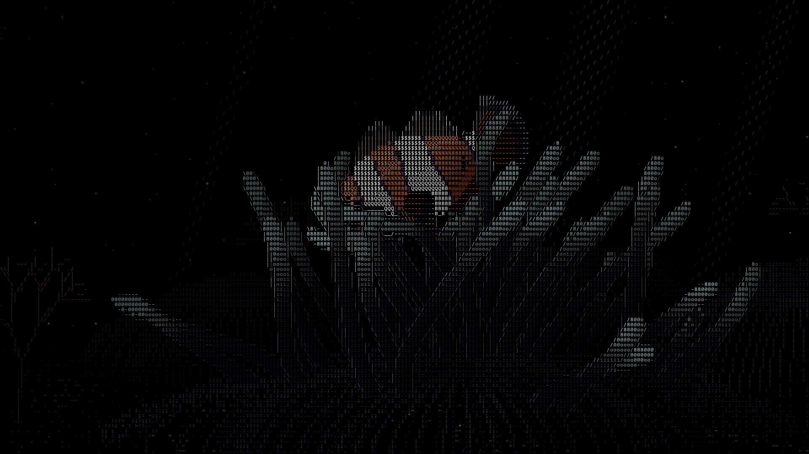
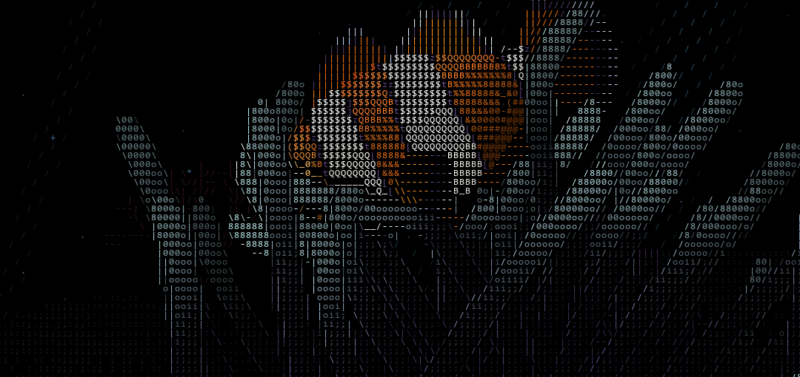

# Clownfish wallpaper

An ASCII clownfish that lives behind your desktop icons. It wanders on its
own, and when you move the mouse it notices, turns, and chases the pointer. One fish
per screen, up to as many screens as you have.

The anemone's tentacles bend away as the fish swims through them and light up where it
brushes past. Plankton in the water flashes when it rushes by and gets dragged along in
its wake. At speed the tail sheds sparks. Ripples of sunlight cross the sand.



Every character is picked by brightness from a ramp, on the GPU. Here it is at full
size. The pale tentacles are the ones the fish has just brushed past:



Built from [ASCII Lab's clownfish](https://github.com/sapozhkov/ascii-lab-public).
See [Credits and licence](#credits-and-licence), which matters here.

## Requirements

- **Windows 10 or 11**, or **macOS**. See the note on macOS below before you try it.
- **Python 3.9 or newer.** [python.org](https://www.python.org/downloads/). On Windows,
  tick "Add Python to PATH" during install.
- A GPU with **OpenGL 3.3** (anything from the last decade). Without one it falls back
  to a CPU renderer that works but is much slower.

## Install

Clone or download, then on Windows double-click:

```
setup.cmd
```

or on macOS:

```
./setup.sh
```

That builds a private virtual environment in `.venv`, installs what it needs, and
checks your machine: Python, OpenGL, fonts, and the screens it found. It touches
nothing outside the project folder.

## Use

| Windows | macOS | |
| --- | --- | --- |
| `start.cmd` | `./start.sh` | start one fish per screen |
| `stop.cmd` | `./stop.sh` | stop them all |
| `check.cmd` | `.venv/bin/python tools/selfcheck.py` | report what your machine can do |
| `install-startup.cmd` | not yet | run it automatically when you log in |
| `uninstall-startup.cmd` | not yet | stop doing that |

On Windows you can also press **Ctrl+Alt+Shift+F** at any time to stop every fish.

Nothing runs at login unless you ask it to. On Windows the startup entry is an
ordinary shortcut in your Startup folder, so it is listed under **Task Manager,
Startup apps**, and you can disable it there.

### Options

Pass these to `start.cmd`, for example `start.cmd --fps 15`:

| | |
| --- | --- |
| `--fps N` | frame rate, default 24 |
| `--bare` | just the fish and its anemone, no sand, rocks or corals |
| `--overlay` | transparent: your own wallpaper shows through instead of black |
| `--solid` | opaque, sitting *over* the desktop icons |
| `--no-gpu` | force the CPU renderer (Windows) |
| `--monitor N` | one screen only, numbered as the self-check lists them |
| `--seed N` | the same fish every time |

## What it costs

Measured on Windows, an RTX 3090 at 1920x1080, 24 fps, per screen:

| | CPU |
| --- | --- |
| screen covered by a window | **0.01%** of the machine |
| screen visible | **~2%** of the machine (about half a core) |

It does not draw a screen that nothing can see, which is most of a working day. With
four screens visible at once expect roughly two cores' worth; it is a toy, so turn the
frame rate down if that bothers you.

GPU load is about 1.5 ms a frame, a few per cent of a mid-range card, at idle clocks.

## Several screens

`start.cmd` runs one process per screen, each on its own core, because a single thread
cannot keep up with two. Each fish watches only its own screen: move the pointer across
and one loses interest while the other wakes up.

Arrangements are read from Windows, so screens above, below, left, portrait, and mixed
resolutions all work. The zoom comes from whichever dimension is tighter, so an
ultrawide shows more water rather than a giant fish, and a portrait screen gets a tall
tank. *Tested on two 1920×1080 screens; other arrangements are correct by construction
and by test, but have not been run on real hardware.*

## macOS: please read this

**The macOS backend has never been run.** It was written on a Windows machine with no
Mac to test on, from Apple's documentation and from several working open-source live
wallpaper projects. It may work; it may fail in an obvious way; it may fail in a
subtle one. Reports and fixes are very welcome.

What it is meant to do: macOS has no `WorkerW`. Every window has a *level* instead, and
the desktop picture and the Finder's icons sit at known ones. The tank puts a
borderless `NSWindow` at `kCGDesktopIconWindowLevel - 1`, which should be above the
picture and below the icons, with `ignoresMouseEvents` so clicks still reach the
desktop.

The three things most likely to be wrong, each marked `CHECK:` in
`tank/macos_backend.py`:

- **The window level.** Projects disagree on the right one, and it has moved between
  macOS releases. If nothing appears, try other values of `DESKTOP_LEVEL_OFFSET`.
- **The OpenGL profile.** macOS only offers forward-compatible core profiles, and a
  3.2 core context gives GLSL 1.50, which is too old for these shaders. It asks for
  4.1 core, which should give GLSL 330.
- **One process, every screen.** Windows runs a process per monitor; macOS wants its
  UI on the main thread, so one process drives them all. With several large displays
  that may not keep up, in which case lower `--fps`.

## How it works

```
tank/fish.py       the fish: parametric body, fins, eyes, the body wave
tank/reef.py       the anemone (a cloth simulation), rocks, sand, corals, plankton
tank/swimmer.py    what the fish decides to do, and the physics that carries it out
tank/render.py     the camera, the glyph atlas, the CPU renderer
tank/scene_gl.py   the GPU renderer, pass 1: the scene into a grid of characters
tank/gpu.py        the GPU renderer, pass 2: that grid into lit letters
tank/glctx.py      an OpenGL context on a plain Win32 window
tank/wallpaper.py  the Windows backend: desktop window, frame loop, one per screen
tank/macos_backend.py  the macOS backend (unverified)
tank/scene.py      one tank: the fish, its reef, and how to draw them. No platform code
tank/app.py        picks a backend for this machine
```

The scene is drawn into a grid, one fragment per character cell (240x90 at 1080p),
with a real depth test, then one fullscreen shader turns each cell into a glyph from an atlas.
Choosing the glyph is shader arithmetic: brightness indexes a ramp. The fish's spine,
pose and lighting happen in the vertex shader, so the CPU uploads its shape once and
sends a dozen numbers a frame.

### Getting behind the desktop icons

Windows draws the wallpaper in a window of class `WorkerW`. The usual trick is to send
`Progman` the undocumented message `0x052C` and live inside the `WorkerW` that appears.
On **Windows 11 24H2 and later this quietly stops working**, and two details cost a lot
of time here:

- **The child window must be `WS_EX_LAYERED`.** On 24H2+ the icons stay inside
  `Progman`, and a child window of the desktop is only composited if it is layered. An
  opaque child renders perfectly and is simply never shown, whether it is a child of
  `WorkerW`, of `Progman`, or of the icon view, and with OpenGL or GDI alike. Add `WS_EX_LAYERED` and
  `SetLayeredWindowAttributes(hwnd, 0, 255, LWA_ALPHA)` and it appears.
- **`0x052C` is reference counted.** `lParam=1` asks for the `WorkerW`; `lParam=0`
  hands it back and Explorer destroys it. The classic recipe sends both, which leaves
  you re-parenting into a dead window. Send only `lParam=1`.

Two more things worth knowing if you touch that code:

- **Only ask for the `WorkerW` if one is not already there.** Asking again makes the
  shell tear down the existing one, destroying every window inside it, including other
  copies of this.
- **The window class holds a raw pointer to the `WNDPROC` for the life of the
  process.** Letting the ctypes callback be collected frees that trampoline under the
  class, and the next message kills the process with no traceback.

A **wallpaper slideshow** rebuilds `WorkerW` every time it changes the picture. That is handled:
the tank notices within two seconds and moves back in. It is why the rebuild path has
to be solid.

## Known limits

- On Windows the behind-the-icons path is verified on build 26300. Other builds take
  one of the documented fallbacks, and the log says which one you got.
- macOS is written but unverified, as above. There is no Linux backend: the renderer is
  portable, but nothing yet knows how to get behind an X11 or Wayland desktop.
- Tested at 100% display scaling. Per-monitor DPI awareness is set, but mixed-scaling
  setups are untested.
- The arms' rim and fill use the interpolated centreline rather than the original's
  nearest-of-54 search, so about 2% of cells choose a different character. Not visible.
- The camera does not move. The original's lazy orbit would be unbearable on a desktop.

If the fish does not appear, read `fishtank-0.log` beside this file: `pythonw` has no
console, so everything goes there, including which desktop window it found.

## Credits and licence

The fish itself, meaning its geometry, its shading, the anemone's cloth simulation,
the glyph ramp and the swimming model, is adapted from **[ASCII Lab](https://github.com/sapozhkov/ascii-lab-public)**
by [@ascii.lab](https://www.instagram.com/ascii.lab/), specifically `01-clownfish`.
That project is the creative work here; this one wraps it in a Windows desktop.


